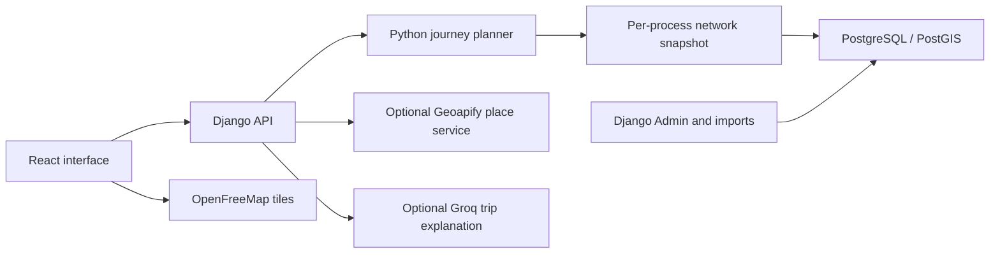

# Architecture

PadungGo separates the commuter interface, deterministic routing, maintained transport records, and optional external services.

SQLite replaces PostgreSQL for local development and automated tests. PostGIS stores geographic fields in production, but current stop-distance filtering and route search run in Python over a loaded network; this is not a spatial SQL routing engine.

## Request flow

1. The interface sends selected coordinates or stored location identifiers.
2. API serializers validate endpoints and search options. The planner loads a network snapshot containing eligible directional patterns, stops, transfers, and supporting data.
3. Search builds direct and one-transfer candidates, assembles segments and uncertainty fields, ranks candidates, groups scarce journeys last, and applies the requested limit.
4. The interface renders steps, geometry, estimates, and warnings. A return trip is a new request.
5. An explanation request sends the search and selected ride identifiers. The server plans again, locates the same rides, and supplies limited facts to the AI provider. AI never writes route records or changes the itinerary.

## Code map

| Location | Responsibility |
|---|---|
| `frontend/src/` | Search, map, results, trip details, fare selection, API client and tests |
| `backend/transit/api/` | Endpoints, serializers, errors, client throttling |
| `backend/transit/planner/loader.py` | Database-to-planner snapshot and invalidation |
| `backend/transit/planner/search.py` | Direct and transfer candidate enumeration |
| `backend/transit/planner/assembly.py` | Segments and journey output |
| `backend/transit/planner/ranking.py` | Supported sorting and fallbacks |
| `backend/transit/planner/fare_quotes.py` | Evidence-supported fare quotation |
| `backend/transit/planner/guide_fares.py` | Separate approximate guide estimates |
| `backend/transit/places/` | Local and provider-assisted place lookup |
| `backend/transit/ai/` | Minimal trip facts, provider client, output checks and caching |
| `backend/transit/models/` and migrations | Persisted network, evidence, versions and provider counters |
| `backend/config/` | Runtime and test settings |

## Caching and scaling

Network snapshots are cached per process for 300 seconds and checked against a shared database version. Model signals and imports invalidate the version; direct database writes can bypass this mechanism. Django's default cache is process-local, so throttles and provider-result caches are not shared between Gunicorn workers or replicas. Provider daily usage counters are stored in the database.

The Docker startup runs migrations and optional administrator bootstrap before two Gunicorn workers. Scaling to multiple replicas needs deliberate migration coordination, shared rate limiting/cache design, database connection budgeting, and measured capacity. There is no load-test evidence establishing a maximum supported network or traffic level.

## Trust boundaries

The default planner admits verified records; deployment enables documented historical records with notices. Status checks do not establish real-world freshness, and review dates do not automatically expire eligibility. The planner does not enforce an exact city boundary. Fare quotation has additional evidence checks, while guide estimates are explicitly approximate.

There is no commuter-history model. Requests, external geocoding, browser tile requests, caches, and infrastructure logs still need privacy consideration. Public stop names passed to AI can reveal an itinerary area even without coordinates. See [security](SECURITY.md), [AI behavior](AI_EXPLANATIONS.md), and [routing](ROUTING_ALGORITHM.md).
