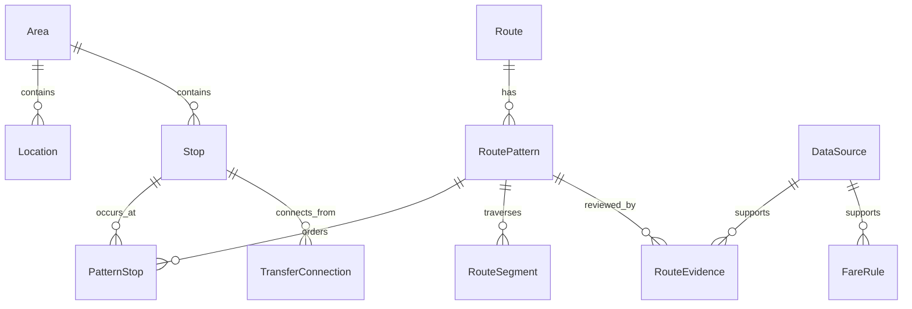

# PadungGo Database Design

**Proposed schema, not implemented migrations.** Supabase PostgreSQL with PostGIS
supports the full location-to-location vision within and across Cebu City,
Mandaue City and Lapu-Lapu City. The MVP populates a verified interconnected
subset; 01K, 23D, 20A and 03Q are research leads, never schema constants.

## Entities and relationships

Names below are canonical design entities; Django can choose conventional physical
table names. UUID primary keys are proposed for public identifiers. Foreign keys
preserve identity independently of route codes and mutable place names.

| Entity | Key fields and relationships | Purpose |
|---|---|---|
| Area | id, name, kind (city/barangay/community), parent_id nullable, boundary nullable, source_id | Hierarchical geographic context; city boundaries need licensed evidence |
| Location | id, name, kind, area_id nullable, point, source_id, verification metadata | Searchable arbitrary places, landmarks and terminals; request coordinates need not be persisted |
| Stop | id, name, area_id nullable, point, boarding/alighting restrictions, status, verified_at | Physical eligible boarding/alighting point; distinct from a general place |
| Route | id, code, name, vehicle_class, operator nullable, active | Service identity; code is not globally unique |
| RoutePattern | id, route_id, variant_key, direction, signboard nullable, geometry, status, verified_at, review_due_at nullable | One directed ordered variant; a route may have many |
| PatternStop | id, pattern_id, stop_id, sequence, distance_along_m, can_board, can_alight | Stop occurrence; a loop may visit one physical stop repeatedly |
| RouteSegment | id, pattern_id, from_occurrence_id, to_occurrence_id, distance_m, geometry nullable, riding_seconds nullable, estimate_basis nullable, source_id | Consecutive occurrences and supported travel metrics |
| TransferConnection | id, from_stop_id, to_stop_id, pedestrian_geometry nullable, distance_m, duration_seconds nullable, restrictions, status, verified_at, source_id | Directed, validated pedestrian transfer; reverse is not assumed |
| FareRule | id, vehicle_class, route_id nullable, pattern_id nullable, passenger_category, currency, policy, valid_from, valid_until nullable, source_id, status | Versioned fare policy with source-backed bands, increments and rounding |
| DataSource | id, title, publisher, url/reference, published_at nullable, collected_at, license/permission, limitations | Evidence and reuse provenance |
| RouteEvidence | id, pattern_id, source_id, observed_at nullable, reviewed_at, reviewer, status, notes | Append-only pattern verification history |
| RecordEvidence | id, source_id, one typed target FK to Area/Location/Stop/PatternStop/RouteSegment/TransferConnection/FareRule, observed_at nullable, reviewed_at, reviewer, status, notes | Evidence history for other routable fields and geography |

A route can cross many areas; do not store only starting/ending city as its spatial
definition. Derive coverage from verified directional patterns and stops. Do not
persist every commuter-selected point as a Location row. Vehicle class and known
operator can initially be controlled fields rather than unnecessary catalog tables.

## Spatial representation and indexes

Use WGS84/SRID 4326 Point fields for locations/stops and LineString or
MultiLineString fields as appropriate for sourced patterns. GeoJSON uses
longitude, latitude. API endpoint objects explicitly name latitude and longitude.
Use geography casts or an appropriate projected coordinate system for meter
calculations; degrees are not meters.

Add GiST indexes on stop/location points and pattern geometry, and on area
boundaries if used. Index (pattern_id, sequence), (stop_id, pattern_id), route
identity, verification status/review date and fare applicability/validity. Use
bounded spatial queries and inspect query plans before adding more indexes.
Hundreds of patterns and thousands of stops do not require sharding or microservices.

## Integrity and validation

- Unique (route_id, variant_key); each direction has its own pattern.
- Unique (pattern_id, sequence); sequence and distances are nonnegative.
  Do not make (pattern_id, stop_id) unique: loops repeat stops.
- Ride boarding occurrence precedes alighting occurrence. Cumulative distance
  cannot decrease. Validate occurrence ordering transactionally on import/admin.
- Segment occurrences belong to the same pattern and are consecutive. Ordinary
  SQL CHECK cannot check other rows: enforce cross-row rules in transactional
  services/import validation and use triggers if a later need justifies them.
- FareRule may target vehicle class, a route, or its matching pattern. Resolve
  most specific applicable verified rule first. Reject overlapping equal-specificity
  rules for a category/date instead of picking arbitrarily. Validate policy
  structure, rounding and distance bands; do not encode invented fare constants.
- Integer centavos for money, meters for distance, seconds for durations.
  Nullable unknown values differ from zero. Amounts and supported times cannot
  be negative. Require valid date ranges and consistent source references.
- RecordEvidence requires exactly one target FK (CHECK); direct typed references
  retain foreign-key integrity. Pattern and other record approvals need evidence,
  observation scope, rights and reviewer metadata.
- PROTECT source/evidence references and published route identities; deactivate
  instead of deleting records required for audit. Never overwrite evidence history.
- RoutePattern.status is a current review projection of RouteEvidence, updated
  atomically by authorized review. Use lowercase candidate/documented/verified/
  needs_review everywhere. Expired or disputed support excludes affected guidance.
- A missing fare or wait does not invalidate an otherwise verified physical route:
  track per-field completeness and emit null estimates. Unsafe/unverified access
  or stop order does invalidate that candidate.

## Walking, transfers and optional time evidence

Access/egress may use a compliant pedestrian provider or curated verified links;
a route-line intersection or straight-line distance is insufficient evidence of
walkability. TransferConnection stores explicit directed connections, including
same-stop reboarding when appropriate. PatternStop flags further restrict boarding
for that service. Recheck all associated stops and links during candidate search.

Optional frequency evidence can later be stored as ServiceWindow(pattern_id,
time_window, headway_seconds/schedule, validity, source_id, status). Omit it from
the initial schema unless real evidence exists; waiting remains unknown. Keep
walking/riding estimation basis with the source-backed metrics.

## Publication, security and growth

Manage records through authorized Django Admin and validated imports; keep private
reviewer details out of public API evidence. Use a least-privilege server database
role, separate migration/admin credentials, backups and restore verification.
The browser uses DRF rather than unrestricted direct Supabase table access.

The MVP search cap is one transfer, not a database restriction. Additional
patterns, stops, areas and transfer links extend the same model without adding
columns for new route codes. Support future multi-transfer search using these
directed relationships. See [routing](ROUTING_ALGORITHM.md) and [API](API_DESIGN.md).
