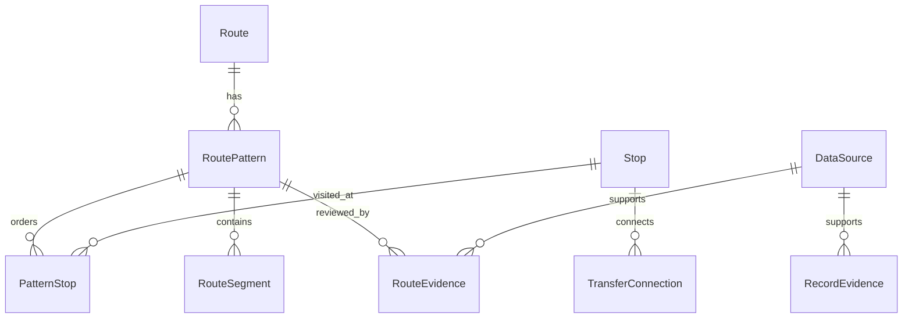

# Database model

The implemented models are in [`backend/transit/models/`](../backend/transit/models). Migrations are in [`backend/transit/migrations/`](../backend/transit/migrations). Production uses PostgreSQL/PostGIS; tests and local development support SQLite representations without geographic libraries.

## Main records

| Model | Role |
|---|---|
| `Area` | Named administrative area with optional parent; no city-boundary polygon |
| `Location` | Searchable place, coordinates, area, kind, aliases, normalized search text and source reference |
| `Stop` | Physical transport point with boarding/alighting flags and status |
| `Route` | Code, name, vehicle class, operator, active flag and service-availability flag |
| `RoutePattern` | Directional route variant, geometry, status, verification and review dates |
| `PatternStop` | An ordered visit to a physical stop, cumulative distance and per-pattern access flags |
| `RouteSegment` | Connection between two stop occurrences, distance, optional ride duration and provenance |
| `TransferConnection` | Directed transfer between physical stops, distance, optional duration and status |
| `FareRule` | Vehicle/passenger applicability, optional route/pattern scope, dates and structured fare policy |
| `DataSource` | Title, reference, publisher, license, publication/retrieval metadata and limitations |
| `RouteEvidence` | Source-backed review of a directional pattern |
| `RecordEvidence` | Source-backed review of one supported non-pattern record |
| `NetworkDataVersion` | Shared invalidation/version timestamp for network caches |
| `ProviderUsage` | Provider/day counters for optional external services |

Most domain records use UUID identifiers. A route code is a display/search value, not a unique primary key. Multiple route records can share a code, especially after imports.

A physical stop may occur repeatedly in a pattern. Boarding and alighting identities therefore refer to `PatternStop` occurrences, not merely a stop name. A transfer is directional; an A-to-B record does not imply B-to-A. Same-stop transfer records are allowed.

## Implemented constraints and validation limits

- `RoutePattern` is unique by route and variant key, not by route/direction/variant together.
- `PatternStop` is unique by pattern and sequence; the same physical stop may appear at multiple sequences.
- `RouteSegment` is unique by pattern and endpoint occurrence pair.
- `TransferConnection` is unique by from/to stop pair.
- `RecordEvidence` requires exactly one supported target; model validation and a database constraint enforce this.
- `ProviderUsage` is unique by provider and day.
- Fare rules include validity/scope constraints and additional model/quotation checks.

Do not assume all intended geographic invariants are database constraints. Consecutive segment structure, cross-row pattern consistency, cumulative-distance quality, safe crossings, current service, and valid reuse rights still need import/application checks and human review. Calling Django model `save()` is not a universal substitute for validation.

Route evidence editing is restricted in Admin, but this is not a cryptographically immutable audit log. Database access can alter records. Review dates are stored but not automatically used to expire planner eligibility.

## Data flow

GTFS import creates documented routes/patterns/stops, not verified observations. Optional imports and Admin tools can add source-backed locations and route corrections. Signals and import completion invalidate the shared network version; direct SQL can bypass these hooks. See [architecture](ARCHITECTURE.md) and [verification](DATA_VERIFICATION.md).

No commuter journey-history table is present. Infrastructure logging, provider processing, and caches remain separate privacy considerations described in [security](SECURITY.md).
