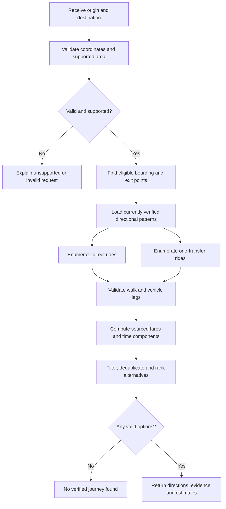

# PadungGo — Routing Algorithm Specification

> **Status:** Proposed design — not yet implemented
> **Project:** PadungGo, an open-source commuter journey planner whose full vision covers location-to-location journeys throughout Cebu City, Mandaue City, and Lapu-Lapu City
> **Backend:** Python + Django REST Framework
> **Database:** Supabase PostgreSQL with PostGIS
> **MVP limit:** Direct public-transport journeys or journeys with **at most one transfer**

## 1. Purpose and guiding rule

PadungGo must answer a commuter's question: **“Which jeepney or bus can I take from here to there, what will the journey involve, and what other valid options are available?”** Its routing engine must provide understandable, direction-correct, source-backed itineraries, not merely draw a line between two coordinates.

**Non-negotiable rule: Do not fabricate routes, stops, transfers, fares, waiting times, or arrival estimates.** A smaller set of trustworthy routes is preferable to broad but misleading coverage.

This document is a **design specification**, not a declaration that data has been verified or that any functionality is implemented.

## 2. Scope, inputs, and outputs

### 2.1 Supported journeys

- Full vision: journeys within a city, barangay or community and between any of the three cities; no required city sequence. Arbitrary valid endpoints do not guarantee verified connectivity.
- MVP: a smaller verified interconnected subset, where current service and directional stops support the request. **01K, 23D, 20A and 03Q are the initial research batch**, not permanent network limits or confirmed services.
- Jeepney and bus services for which sufficient records exist.
- Zero or one public-transport transfer. A direct trip has one vehicle leg; a one-transfer trip has two vehicle legs.
- Multiple *distinct, valid* alternatives for outbound and return trips when the data supports them.
- A clear *no verified journey found* response when the network cannot support a request.

**Out of scope for MVP:** live jeepney GPS tracking, guaranteed arrival times, arbitrary numbers of transfers, tickets/payments, nationwide coverage, and inferred routes from stale sources.

### 2.2 Origin and destination selection

Each endpoint is converted to a validated geographic coordinate, regardless of how the commuter selects it:

| Input method | Handling |
|---|---|
| Device GPS | Browser asks permission; coordinate is sent only for trip calculation. |
| Search by name | Resolve a selected search result to coordinates; do not route using raw text alone. |
| Tap on map | Use the selected map point coordinates, then check service-area coverage. |
| Predefined landmark | Use its curated location ID and verified coordinates. |

An origin and destination may be arbitrary points near the supported network. **A point near a route line is not necessarily a valid boarding point.** Only eligible stops/boarding places can begin or end a vehicle leg.

Validate finite latitude and longitude within geographical bounds, optional IDs, supported-area conditions, and request size. Do not log precise location history by default.

### 2.3 Output per alternative

Each result should contain:

- Stable journey-option identifier (for the response), number of transfers, and applicable ranking labels.
- Ordered walking, vehicle, and transfer segments with instructions.
- Vehicle **route code, operator/variant when known, and travel direction** for each ride.
- Verified board/alight locations and transfer instructions.
- Per-ride estimated fare and **total estimated fare**; source, effective date, and assumptions when available.
- **Walking**, **waiting**, and **riding** durations *separately*, with evidence/assumptions and explicit unknown values.
- Appropriate total-time label: complete estimate only when all required components are supportable; otherwise **partial estimate / waiting unknown**.
- Route provenance, last-verified dates, and limits on accuracy.
- Polylines for available verified ride geometries, plus appropriately sourced pedestrian paths when available.

Use `null` (or an explicit `unknown` state) for missing amounts/times. **Unknown is not zero.**

## 3. Verification gate: which data is routable?

Store independently identifiable **route patterns**. The route code alone is insufficient: there may be differences in operator, vehicle type, variant, and inbound/outbound streets.

Candidate lifecycle:

| Status | Meaning | Eligible for trusted journey search? |
|---|---|---|
| `candidate` | Found in an unconfirmed or historical source | **No** |
| `documented` | Has a published description, but present operation/direction is unconfirmed | **No** |
| `verified` | Current route pattern and its usable stops validated against sufficient evidence | **Yes** |
| `needs_review` | Conflicting, stale, or changed evidence | **No**, until reverified |

Verification checklist before a route pattern is activated:

1. Identify route code, vehicle category, and operator/variant when available.
2. Confirm **current service** using reliable evidence.
3. Confirm each direction **separately**; do not assume symmetry.
4. Confirm safe/authorized boarding, alighting, and transfer points.
5. Confirm the applicable fare category, rules, source, and effective date.
6. Retain source URLs or evidence, observed date, verification date, and reviewer notes.
7. Confirm legal permission to reuse and redistribute route and geometry data.

A verified pattern may have partial time data. That does **not** justify inventing its frequency or waiting time. Independently flag uncertain subfields. A new conflicting source should place relevant records under review rather than silently replacing the evidence history.

## 4. Minimum routing data model

The canonical proposed entities are defined in [DATABASE_DESIGN.md](DATABASE_DESIGN.md): `Area`, `Location`, `Stop`, `Route`, `RoutePattern`, `PatternStop`, `RouteSegment`, `TransferConnection`, `FareRule`, `DataSource`, `RouteEvidence` and `RecordEvidence`. This replaces the earlier route_stops/route_sources blueprint; physical names remain an implementation detail. Routing consumes directional patterns and stop occurrences rather than fixed codes or city endpoints.

| Concept | Fields required by routing | Reason |
|---|---|---|
| Location | `id`, name, coordinates, type | Supports curated landmarks and search |
| Stop / boarding point | `id`, name, coordinates, safe boarding/alighting flags | Legal and practical embarkation |
| Route | `id`, route code, vehicle type, operator/variant identity | Distinguishes services |
| **Route pattern** | `id`, `route_id`, direction, geometry, verification status, verified date | Represents one traversable ordered direction |
| **Pattern stop** | `pattern_id`, `stop_id`, sequence, distance along pattern, board/alight flags | Correct ride order and distance |
| Route segment | pattern ID, consecutive stop IDs, route distance, supported ride-time estimate and its basis | Fare and travel-time calculations |
| Fare rule | vehicle category, rate structure, currency, distance rule, effective date, source | Versioned cost calculations |
| Source/evidence | publisher, URL/reference, observed/published dates, evidence type, rights, review record | Provenance and auditability |
| Service-frequency evidence (optional) | pattern, time window, headway/schedule, date verified | Conditional waiting-time estimation |

**Important integrity constraints**

- `(pattern_id, sequence)` must be unique and ordered. Repeated physical stops on a loop must remain distinguishable by sequence/occurrence.
- Vehicle legs must proceed from **lower to higher sequence** on one particular route pattern.
- Route segments join consecutive occurrences along a pattern; do not substitute straight-line stop distance for vehicle-route distance.
- For route results, source references are mandatory for approved route patterns; preserve verification history.
- Geographic coordinates use a consistent WGS84 convention; store distances in **meters**, durations in **seconds**, and money as **integer centavos** or fixed-precision decimal (never floating-point money).
- Foreign keys, database checks, sensible delete restrictions, and indexes prevent orphaned or contradictory data.

## 5. Routing workflow



### Step 1 — Validate request

Validate location coordinates and IDs and bound the search area, search radius, transfer count, and maximum number of results. Reject invalid inputs rather than coercing them into plausible locations. Protect the endpoint with throttling and request limits.

### Step 2 — Find suitable nearby stops

- Find *boarding-eligible* points near the origin and *alighting-eligible* points near the destination.
- Search by PostGIS proximity when available. For a tiny dataset, bounded in-memory distance filtering can be used initially.
- A simple Haversine distance is a **candidate filter**, not a walking route. Where a pedestrian routing service is available, validate walkability, access, and walking time along the street network.
- Transfers likewise require walkable connectivity between an alighting stop and a subsequent boarding stop. **Do not permit a transfer just because two route lines cross on a map.**
- If only straight-line estimates are available, show that qualification and avoid claiming accessible pedestrian guidance.

Use a configurable walking radius appropriate to the MVP and document it; do not assume a specific radius is always safe or desirable.

### Step 3 — Enumerate direct trips

For each **verified** directional pattern:

1. Identify reachable boarding stop occurrences on the pattern.
2. Identify destination-reachable alighting occurrences **later in the sequence**.
3. Construct one vehicle leg plus walking portions.
4. Reject routes lacking credible boarding/alighting or geographic information needed for the claimed instruction.

### Step 4 — Enumerate at most one transfer

For ordered pairs of verified patterns `(P1, P2)`:

1. Board `P1` at a valid origin-accessible occurrence.
2. Alight `P1` at a transfer-accessible occurrence.
3. Find a walkable connection to a boarding occurrence on `P2`.
4. Ride `P2` to a destination-accessible later stop occurrence.
5. Require correct sequence order on **both** patterns; forbid reverse traversal of a one-way pattern.
6. Reject journeys with more than one transfer, impossible walks, duplicate redundant legs, or unsupported guidance.

A pattern pair sharing the same route code may still represent different variants; determine whether a genuine reboarding/transfer is needed based on the actual itinerary, not the code string.

### Step 5 — Estimate fare **per boarding**

For each vehicle leg:

- Obtain distance traveled **along that leg's verified route path or segment distances**.
- Find the correct fare rule by vehicle type, service/route if applicable, validity date, and passenger category (if supported).
- Apply its base distance, increments, minimums, rounding and discount rules **only when verified**.
- Sum individual leg fares; transferring generally causes a new charge unless a documented fare policy says otherwise.
- If relevant fare rules or distance are missing, report fare as **unknown**, not ₱0, and do not label the itinerary cheapest.

**Never hardcode a claimed 2026 fare without its authoritative source and effective date.** Use synthetic prices only in clearly marked algorithm tests.

### Step 6 — Estimate travel durations honestly

| Component | Estimation basis | Missing data behavior |
|---|---|---|
| Walking | Routed pedestrian distance + documented speed, or permitted pedestrian-routing service | Unknown or explicitly approximate; do not treat straight-line travel as navigable |
| Waiting | Verified timetable, service frequency/headway for a time window, or supported observations | `unknown`; do not invent 5–15 minutes or label live ETA |
| Riding | Verified segment observations/schedules, or distance plus clearly documented non-live speed assumptions | Unknown or qualified estimate |
| Transfer | Transfer walking plus waiting for the next ride | Unknown components remain unknown |

**Complete duration** = walking + waiting + riding (+ any explicitly modeled transfer overhead), *only* if components can be estimated for every leg. Otherwise show **known subtotal** and state what is excluded; avoid an unqualified “fastest” ranking when unknown waits materially affect comparison.

No real-time vehicle ETA should be claimed without a genuine, authorized live vehicle data feed.

### Step 7 — Rank and diversify meaningful choices

Aim for **3–5 distinct valid itineraries**; default limit 5, returning fewer when fewer exist:

1. **Lowest fare:** only when total fares are comparable and known.
2. **Shortest estimated duration:** only where sufficiently comparable total durations are available; otherwise label as *estimated riding/walking time excluding unknown waiting*.
3. **Fewest transfers:** prioritize direct trips and simpler instructions.

Other useful tie-breakers: shorter walking distance, higher-quality evidence, and fewer uncertain components. Do not insert fake alternatives, inflate rankings based on missing data, or conflate *more recently verified* with *real-time vehicle availability*.

**Deduplication:** two result candidates sharing the same boarding point, ride pattern(s), transfer point(s), and alighting point should ordinarily be treated as one itinerary, even if the search found them through different nearby landmark candidates.

### Step 8 — Explain each itinerary

The output instructions should make sense without staring at a map:

1. Walk to a named, eligible boarding location.
2. Board a named route/pattern in the stated **direction**.
3. Alight at a named verified location.
4. If required, walk to the connecting boarding point and ride the second service.
5. Walk from final alighting location to destination.
6. Show fares, separate time components, evidence dates, and limitations.

Do not infer a stop or exact boarding position from an arbitrary route line intersection.

## 6. Return trips and multiple suggestions

**Reversing instructions is incorrect.** To find return options, call the same planner with the destination as the new origin and the original origin as the new destination:

```text
Outbound: plan(origin=A, destination=B)
Return:   plan(origin=B, destination=A)
```

The return search independently selects eligible boarding points, direction-specific patterns, transfers, fares, and walking legs. It may return **different routes, different transfer points, a different number of alternatives, or no verified option**. Always rank return options independently.

The canonical MVP uses **only** `POST /api/v1/journeys/plan` for both directions. No dedicated `/return` endpoint is specified; see [API_DESIGN.md](API_DESIGN.md).

## 7. API contract expectations

[API_DESIGN.md](API_DESIGN.md) owns exact request/response types. Use
`POST /api/v1/journeys/plan` with coordinate-or-location-ID endpoints,
`max_transfers` 0–1, `limit` 1–5 (default 5), and `sort_by`.
The same endpoint computes an independent return request.

Return `journey_options`, `request_coverage_status`, `reason`, `ranking`
and `warnings`. Each option contains ordered segments, per-leg fares, total
fare completeness, walking/waiting/riding components, known subtotals, complete
total only when supported, public evidence and limitations.

Use HTTP 400 for invalid requests and HTTP 200 with an empty option list and
explicit reason for valid unsupported/no-journey requests, including points
outside the intended area. Database or required-provider failures use safe
HTTP 503 errors rather than being misrepresented as missing coverage. Do not
expose private reviewer details or raw database exceptions.

When cheapest/fastest cannot fairly order all results, use fewest transfers
then known walking distance with deterministic tie-breaks and disclose the
fallback. Unknown values must never win a ranking by being interpreted as zero.

## 8. Failure handling and user messaging

| Situation | Correct behavior |
|---|---|
| GPS permission denied | Offer name search, map selection, or curated locations. |
| Origin/destination unsupported | Say outside current verified coverage; do not assume a route. |
| No direct ride but one-transfer exists | Return valid connecting itineraries only. |
| No verified ride in either direction | Return an explicit no-results state; optionally show coverage limitations. |
| Outbound works but return does not | Show outbound; separately warn that no verified return is available. |
| Waiting-time evidence missing | Show `Waiting: unknown`; do not include fictional wait in total. |
| Fare rate unknown or outdated | Show unknown/needs verification rather than a guessed cost. |
| Contradictory sources | Mark relevant pattern needs review and exclude from trusted recommendations. |
| Walking service unavailable | Avoid fabricated turn-by-turn walking directions; qualify approximate distances. |
| Database/network timeout | Return safe, retryable error with no partial misleading “confirmed” route. |

**Accessibility:** every result must have plain text instructions, sensible reading order, and labels that do not rely on map colors alone.

## 9. Performance and security boundaries

- Query only supported geographical extent, verified patterns, and a limited nearby-stop set. Cap response length, search candidates, and transfers.
- Add database indexes on status/direction, route-pattern sequence, and geographic columns where PostGIS geometry/geography is used.
- Cache only public, nonpersonal route and landmark records where practical; invalidate after route corrections.
- Do not persist a commuter's precise GPS or journey history for the MVP. Remove precise coordinates from analytics/error logs.
- Validate all server-side input with Django REST Framework serializers; use parameterized ORM queries and controlled geospatial operations.
- Rate-limit public trip-planning requests; configure HTTPS, allowed hosts and restricted CORS for the deployed frontend.
- Keep database credentials, Django `SECRET_KEY`, and any map/geocoding API secrets on the server, never in Git or the React bundle.
- Admin changes to verification records must require authorization and be auditable; do not expose unpublished route evidence through public APIs.
- Follow terms, attribution, and licensing for map tiles, pedestrian routing, GTFS, and third-party route datasets.

## 10. Testing plan and acceptance criteria

Use **synthetic route patterns** in tests, clearly separated from real Cebu route data, so algorithm correctness does not depend on whether route collection is complete.

| Test | Expected result |
|---|---|
| Verified pattern contains board stop before exit stop | Returns direct ride. |
| Exit stop precedes board stop on same directional pattern | Does **not** return reversed ride. |
| Two verified patterns connect via valid walkable transfer | Returns one-transfer ride. |
| Three vehicle legs required | Returns no itinerary in MVP. |
| Patterns cross on map but no authorized/walkable interchange | Rejects transfer. |
| Pattern is candidate, documented, or needs review | Excludes it from trusted results. |
| Historical fare rule is superseded | Applies valid date-aware rule or reports unknown. |
| Waiting estimate unavailable | Returns `null` and flags total duration incomplete. |
| Two searches produce equivalent path | Deduplicates itinerary. |
| Only one valid itinerary exists | Returns one, does not invent more. |
| Reverse-direction pattern absent | Outbound can succeed; return reports no result. |
| Both directions have different paths | Return uses independently matched stops and patterns. |
| Unknown fare on one leg | Total is unknown rather than silently treating the leg as free. |
| Invalid/out-of-range coordinates | Server rejects clearly and safely. |
| GPS is denied | Manual methods remain usable. |

**MVP done means:** At least one *real, source-evidenced* connected subset can be queried in both directions where verified data exists; all returned legs honor stop direction and verified eligibility; fare/time components are labeled honestly; backend tests for the cases above pass; React presents understandable instructions and error states. If real data is insufficient, do not represent synthetic demos as verified commuter guidance.

## 11. Step-by-step implementation order (later; no code in this document)

1. **Confirm transport data and schema:** source evidence, route variants, directional stop occurrences, coordinates, valid boarding/alighting, fare metadata.
2. **Build tiny synthetic fixtures:** one direct route, one connecting route, one asymmetric return direction, one invalid transfer.
3. **Define data access layer:** query verified patterns and eligible nearby stops; never mix `candidate` with trusted routing results.
4. **Implement direction-safe direct enumeration** and unit tests.
5. **Implement exactly one transfer enumeration**, walkability checks, and tests.
6. **Implement fare service** with versioned source-backed fare rules.
7. **Implement time-component estimator** with unknown-state propagation and clearly documented assumptions.
8. **Implement result ranking, deduplication, and alternatives**, including independent return search.
9. **Expose/validate REST response** and test successful, unsupported, invalid, and empty results.
10. **Connect map UI and text instructions**, then run end-to-end tests with a limited *verified* Cebu network.
11. **Profile and refine** only after route accuracy, safety, and deployment are established.

Each milestone requires a passing test and a documented Git commit before expanding scope.

## 12. Decisions requiring approval or source evidence

These must be resolved before promising specific behaviors:

1. **MVP subset and first verified route patterns:** route operators, direction variants, actual boarding/alighting points, and source reuse rights.
2. **Walking eligibility:** maximum candidate radius, whether we have a compliant pedestrian routing service, and how to handle inaccessible streets/bridges.
3. **Fare rules:** official fare-matrix structure, rounding, passenger categories, and source/effective dates.
4. **Waiting-time basis:** whether verified headways/schedules exist; without them, waiting stays unknown.
5. **Travel-time ranking:** whether sufficiently comparable totals exist to call an option “fastest.”
6. **Proposed schema:** `DATABASE_DESIGN.md` now defines direction-aware entities; owner review precedes migrations.
7. **Result limit resolved in this design:** default 5, aiming for 3–5 distinct alternatives and returning fewer when fewer exist.

---

**Guiding principle:** *A route recommendation is only as trustworthy as the directional transport records, boarding information, and evidence that support it.*
