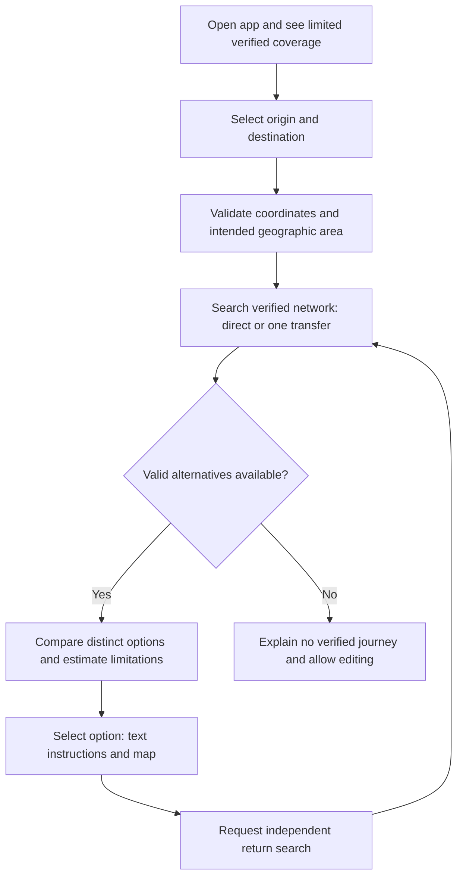

# PadungGo User Flow

**Planned behavior; no working interface exists yet.** The full vision covers
locations within and across Cebu City, Mandaue City and Lapu-Lapu City. The MVP
can recommend only a verified interconnected subset; 01K, 23D, 20A and 03Q are
research leads, not selectable verified services by default.

## Main journey

## Endpoint selection

For either endpoint, offer current GPS location with permission, manual name
search, map-point selection, or predefined places/landmarks/terminals. Resolve
search selections to coordinates; show ambiguous matches for confirmation.
Allow changing either point and swapping endpoints. GPS denial or inaccuracy
leads to manual alternatives. Do not require GPS merely to select a destination.

Accept points in any of the three cities, including two points in the same city
or barangay. First check geographic validity, then transport coverage. Explain
that a selectable place may lack verified connections; never silently snap a
location to a different city or imply that city inclusion guarantees a journey.

## Results and instructions

Aim for 3–5 distinct valid alternatives, showing fewer when fewer exist. Multiple
labels on one alternative do not create additional journeys. Show fare, supported
duration components, transfers and walking distance to support comparison.

For the selected option, present sequential text and matching map segments:

1. Walk to the named eligible boarding location using supported pedestrian data.
2. Recognize the jeepney/bus, route code or signboard, and direction.
3. Ride to the named alighting point.
4. If needed, walk to the connecting boarding location and board the next service.
5. Alight and complete the final walk to the selected destination.

Map origin/destination, boarding/alighting points, ride geometries, transfer
points and supported walks; switching alternatives updates the highlighted path.
Keep route identity and stop instructions understandable without map colors.

Show per-leg and total fare, source/effective date, assumptions and uncertainty.
Separate walking, waiting and riding. Unknown components remain unknown; show a
known subtotal with exclusions rather than an apparently complete trip duration.
Show verification dates, evidence references and limits, not a real-time badge.

## Return flow

Request B→A through the same planner with independently selected directional
patterns, stops, transfers, costs and ranking. Offer multiple distinct return
options when available; never reverse the outbound instructions mechanically.
Preserve outbound results if the return has no verified option.

## Failure and incomplete-data states

| State | User-facing behavior |
|---|---|
| GPS denied/unavailable | Explain briefly and retain search, map and predefined inputs |
| Invalid coordinate or ambiguous search | Identify the affected field; let the user correct/select it |
| Outside intended three-city area | Explain geographic scope and allow a new selection |
| Inside area but insufficient verified data | Explain limited coverage without claiming no public service exists |
| No itinerary within one transfer | Say no verified journey under MVP limits; allow endpoint edits |
| Missing/stale route direction or unsafe transfer | Exclude it from guidance rather than infer a connection |
| Unknown fare or time | Keep valid ride guidance; label unknown estimate and disable unsupported ranking claims |
| Walking provider unavailable | Explain missing pedestrian guidance; exclude journeys whose access cannot be established |
| API/network failure | Keep inputs, show retry, and distinguish failure from genuine no-results |
| Return unavailable | Explain separately; retain outbound itinerary |

## Accessibility and privacy

Use keyboard-operable selectors and map alternatives, labeled fields, clear focus,
readable text/contrast, screen-reader status messages and non-color identifiers.
Explain GPS consent; do not store precise commuter location history or expose it
in analytics/logs. See [API states](API_DESIGN.md) for the matching response contract.
